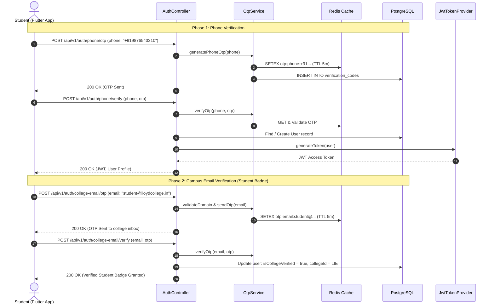

# 🛡️ VibeConnect - Backend API Service

> **"Meet through moments, not swipes."**  
> High-performance REST & STOMP WebSocket backend for VibeConnect — a moments-based campus dating and social connection platform.

---

## 📋 Overview & Completed Milestones

The backend service is engineered with **Java 21** and **Spring Boot 3.3.5**. It powers the core identity verification, anti-scam authentication, local campus graph scoping, and reciprocal moment unlocks.

### ✅ What Has Been Implemented:
* **Stateless Security & JWT**: Spring Security 6 with HS256 JWT tokens (24h access token, 7-day refresh token) via `JwtAuthenticationFilter` and `JwtTokenProvider`.
* **Two-Tier Anti-Scam Verification**:
  1. **Phone OTP Verification**: Generates secure 6-digit OTPs and validates phone numbers.
  2. **Campus Email Verification**: Validates institutional email domains (`@lloydcollege.in`, `@bennett.edu.in`, `@amity.edu`, etc.) to grant verified student badges.
* **Dual-Layer OTP Storage (Redis + Database)**:
  - High-speed ephemeral TTL caching via **Redis 7** (5-minute expiry).
  - Persistent fallback and audit logging in PostgreSQL via `VerificationCode` entity.
* **Campus Directory & Flagship Scoping**:
  - Pre-seeded Greater Noida & Noida colleges with **Lloyd Institute of Engineering and Technology (LIET)** prioritized at the top.
* **Automated Database Migrations**:
  - **Flyway** migration scripts (`V1__init_schema.sql`, `V2__verification_codes.sql`) initializing PostgreSQL relational tables, indexes, and foreign keys automatically on boot.
* **Cross-Origin Resource Sharing (CORS)**: Configured for Flutter Web (`http://localhost:3000`) and mobile clients.

---

## 🏗️ Architecture & Tech Stack

```
backend/
├── src/main/java/com/vibeconnect/
│   ├── controller/         # REST Controllers (Auth, Colleges)
│   ├── dto/                # Data Transfer Objects & API response wrappers
│   ├── model/              # JPA Entities (User, College, VerificationCode, DatingIntent)
│   ├── repository/         # Spring Data JPA repositories
│   ├── security/           # JWT Provider, Security Filters, WebSecurityConfig
│   ├── service/            # Business logic (AuthService, OtpService, CollegeService)
│   └── VibeConnectApplication.java # Spring Boot entrypoint
└── src/main/resources/
    ├── application.yml     # Configuration & environment variable mappings
    └── db/migration/       # Flyway SQL migration scripts (V1, V2)
```

* **Runtime:** Java 21 (or compatible OpenJDK / Temurin)
* **Framework:** Spring Boot 3.3.5
* **Persistence:** Spring Data JPA / Hibernate, Flyway Migrations
* **Database:** PostgreSQL 16 / 17 (port `5433` or `5432`)
* **Caching & Real-time:** Redis 7 (port `6379`), Spring WebSocket (STOMP)
* **Build Tool:** Apache Maven 3.9+ with Lombok Annotation Processor

---

## 🔄 End-to-End Workflow



---

## ⚙️ Configuration & Environment Variables

All settings can be overridden via environment variables in `application.yml`:

| Environment Variable | Description | Default Value |
| :--- | :--- | :--- |
| `DB_HOST` | PostgreSQL hostname | `localhost` |
| `DB_PORT` | PostgreSQL port | `5433` (Docker default) |
| `DB_NAME` | Database name | `vibeconnect` |
| `DB_USER` | Database username | `vibeuser` |
| `DB_PASS` | Database password | `vibepassword` |
| `REDIS_HOST` | Redis host | `localhost` |
| `REDIS_PORT` | Redis port | `6379` |
| `SERVER_PORT` | HTTP port | `8080` |
| `JWT_SECRET` | 256-bit Hex secret key | `404E635266556A586E3272...` |

---

## 🚀 How to Run the Backend

### Prerequisites
- **Java 21+** (`java -version`)
- **Apache Maven 3.9+** (`mvn -v`)
- **PostgreSQL** running on port `5433` (or `5432`)
- **Redis** running on port `6379`

### Option 1: Native Windows Setup (Current Workspace Setup)

1. **Start Redis:**
   ```powershell
   Start-Service Redis
   ```

2. **Start PostgreSQL Instance:**
   ```powershell
   & "C:\Program Files\PostgreSQL\17\bin\postgres.exe" -D "$HOME\vibeconnect_pgdata" -p 5433
   ```

3. **Compile and Run Backend:**
   ```powershell
   cd backend
   mvn spring-boot:run
   ```

### Option 2: Docker Compose Setup
From the project root:
```bash
docker compose up -d
cd backend
mvn spring-boot:run
```

Once booted, the server is live at: **`http://localhost:8080`**.

---

## 📡 API Reference

### 1. Campus Discovery
* **`GET /api/v1/colleges`**
  - **Description:** Returns all verified colleges, with LIET prioritized first.
  - **Sample Response:**
    ```json
    {
      "success": true,
      "message": "Colleges fetched successfully",
      "data": [
        {
          "id": "1a6cd6d5-9853-4fdc-8489-930347a045a0",
          "name": "Lloyd Institute of Engineering and Technology",
          "shortCode": "LIET",
          "emailDomain": "lloydcollege.in",
          "city": "Greater Noida",
          "locality": "Knowledge Park II"
        }
      ]
    }
    ```

### 2. Phone Authentication
* **`POST /api/v1/auth/phone/otp`**
  - **Payload:** `{"phoneNumber": "+919876543210"}`
  - **Response:** `{"success": true, "message": "OTP sent successfully"}`

* **`POST /api/v1/auth/phone/verify`**
  - **Payload:** `{"phoneNumber": "+919876543210", "otp": "123456"}`
  - **Response:** Returns JWT token and User DTO.

### 3. Campus Email Verification
* **`POST /api/v1/auth/college-email/otp`**
  - **Payload:** `{"collegeEmail": "student@lloydcollege.in"}`
  - **Response:** `{"success": true, "message": "Verification code sent to college email"}`

* **`POST /api/v1/auth/college-email/verify`**
  - **Payload:** `{"collegeEmail": "student@lloydcollege.in", "otp": "123456"}`
  - **Response:** Returns updated profile with verified college badge.
