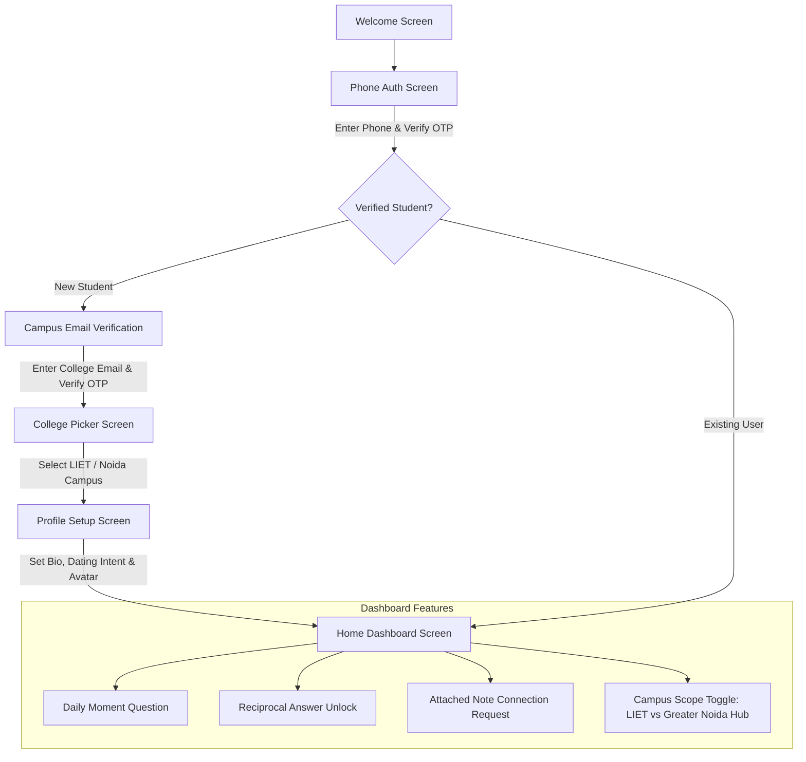

# 📱 VibeConnect - Mobile Application

> **"Meet through moments, not swipes."**  
> Cross-platform Flutter client for VibeConnect — designed specifically for college students across Greater Noida and Noida campuses.

---

## 🌟 Overview & Completed Features

The mobile frontend is crafted using **Flutter 3.x**, **Dart 3.x**, and **Flutter Riverpod**. It replaces traditional swipe mechanics with genuine question-based moments, attached personal notes, and verified campus identity badges.

### ✅ What Has Been Implemented:
* **Complete Onboarding & Auth Funnel**:
  1. **Welcome Screen**: Brand intro with feature highlights and one-tap entry.
  2. **Phone Number & OTP Authentication**: Mobile OTP input with resend timer and error validation.
  3. **Institutional College Email Verification**: Anti-scam verification with college email validation (`@lloydcollege.in`, `@bennett.edu.in`, etc.) to earn a verified student badge.
  4. **College Picker Screen**: Interactive directory of Greater Noida & Noida colleges with **LIET (Lloyd Institute of Engineering and Technology)** highlighted.
  5. **Profile & Moments Setup**: Upload avatar, select dating intent (Casual, Long-Term, Study Buddy, etc.), and draft initial profile notes.
  6. **Home Dashboard & Daily Moment Feed**:
     - Daily question drop ("What song defines your semester right now?").
     - **Reciprocal Unlock**: Answers from peers remain blurred until you answer.
     - **140-Character Personal Note**: Direct connection requests tied to answers rather than mindless swipes.
* **Declarative State Management**: Powered by **Riverpod 2.x** (`auth_provider.dart`, `college_provider.dart`).
* **Robust Networking**: **Dio HTTP Client** configured with JWT bearer token interceptors and dynamic base URLs.
* **Modern UI & Design System**: Custom theme with Google Fonts (`Plus Jakarta Sans`), gradient accents, and student-focused ergonomics.

---

## 📱 User Journey & Screen Workflow



---

## 🏗️ Folder Structure

```
mobile/
├── lib/
│   ├── core/
│   │   ├── api/
│   │   │   └── api_client.dart       # Dio HTTP client, base URL & auth headers
│   │   └── constants/
│   │       └── app_colors.dart       # Brand color palette & gradients
│   ├── models/
│   │   ├── college.dart              # College model (id, name, shortCode, domain)
│   │   └── user.dart                 # User model & verification states
│   ├── providers/
│   │   ├── auth_provider.dart        # Riverpod auth state notifier
│   │   └── college_provider.dart     # Riverpod colleges query provider
│   ├── screens/
│   │   ├── welcome_screen.dart       # Initial splash & landing screen
│   │   ├── phone_auth_screen.dart    # Mobile number & OTP entry
│   │   ├── campus_verify_screen.dart # College email verification screen
│   │   ├── college_picker_screen.dart# College selector (LIET, Bennett, etc.)
│   │   ├── profile_setup_screen.dart # Profile bio, intent & pictures
│   │   └── home_dashboard_screen.dart# Daily moment feed & reciprocal unlock
│   └── main.dart                     # App entry point, Riverpod ProviderScope, routes
└── pubspec.yaml                      # Dependencies & asset declarations
```

---

## 🛠️ Tech Stack & Key Packages

| Package | Version | Purpose |
| :--- | :--- | :--- |
| `flutter_riverpod` | `^2.6.1` | Reactive state management & dependency injection |
| `dio` | `^5.4.3+1` | HTTP client with interceptors, timeouts, and JSON mapping |
| `go_router` | `^14.8.1` | Declarative URL routing and page navigation |
| `google_fonts` | `^6.3.3` | High-quality typography (`Plus Jakarta Sans`) |
| `intl` | `^0.19.0` | Date, time, and number formatting |

---

## 🚀 How to Run the Mobile App

### Prerequisites
- **Flutter SDK 3.24+** installed (available in `C:\src\flutter\bin`)
- **Google Chrome** (for instant web preview) or an Android/iOS emulator

### Step 1: Install Dependencies
From the `mobile/` directory:
```bash
flutter pub get
```

### Step 2: Configure Backend Base URL
In [lib/core/api/api_client.dart](file:///c:/Users/asus/OneDrive/Desktop/Vibe-Connect/mobile/lib/core/api/api_client.dart):
* **Chrome / Desktop:** Defaults to `http://localhost:8080`
* **Android Emulator:** Use `http://10.0.2.2:8080`
* **Physical Device:** Use your computer's local Wi-Fi IP (e.g. `http://192.168.1.X:8080`)

### Step 3: Run the Application

#### Option A: Run in Google Chrome (Fastest for UI Development)
```bash
flutter run -d chrome --web-port 3000
```

> 💡 **Mobile Frame Preview in Chrome:**
> 1. In Chrome, press **`F12`** to open Developer Tools.
> 2. Press **`Ctrl + Shift + M`** (Toggle Device Toolbar).
> 3. Select **iPhone 14 Pro** or **Pixel 7** to view the app in authentic mobile aspect ratio.

#### Option B: Run on Windows Desktop
```bash
flutter run -d windows
```

#### Option C: Run on Android Emulator / Physical Device
```bash
# List available devices
flutter devices

# Launch on connected device or emulator
flutter run
```
